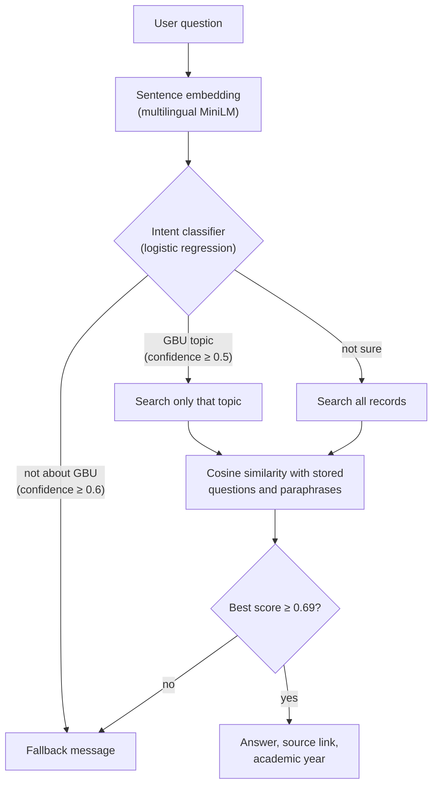

# Ask GBU

A college FAQ chatbot for Gautam Buddha University (GBU), Greater Noida. It answers common questions about admissions, fees, hostels, scholarships, and contacts in English, Hinglish, and Hindi. It uses sentence embeddings for retrieval and an intent classifier for topic routing.

> **Disclaimer:** This is an unofficial student project. It is **not** an official Gautam Buddha University service. For official information, visit [gbu.ac.in](https://www.gbu.ac.in).

## Status

Working prototype. Roadmap phases 0 to 5 are done: knowledge base, retrieval, chat UI, intent classifier, and evaluation. Phase 6, packaging and demo, is in progress. See [docs/ROADMAP.md](docs/ROADMAP.md).

## What it does

- Answers only from a small knowledge base of facts checked against official GBU sources.
- Every answer shows its official source link and the academic year it applies to.
- Understands English, Hinglish ("hostel ki fees kitni hai"), and Hindi in Devanagari ("हॉस्टल की फीस कितनी है").
- Says "I don't have a verified answer" instead of guessing, both for off-topic questions and for GBU questions it has no data for.
- A "How was this matched?" panel shows the detected topic, the similarity score, and the closest stored questions.

## How it works



1. **Embedding:** The question becomes a 384-number vector using `paraphrase-multilingual-MiniLM-L12-v2`. Questions with similar meaning get similar vectors, even across languages.
2. **Intent classifier:** A logistic regression on the same vectors predicts the topic: admissions, contacts, fees, hostel, scholarships, or other. It is trained on `data/intent_dataset.csv` when the app starts. A fine-tuned DistilBERT was also tried and scored lower (87.3% against 90.7%). See `src/intent_model.py`.
3. **Retrieval:** Every record's question and paraphrases are stored as vectors. The best cosine-similarity match wins.
4. **Threshold and fallback:** If the best score is below 0.69, the bot refuses. The value was tuned on a separate dev set (see Evaluation).

## Setup

Requires **Python 3.11 or newer**. Works on Windows, Linux, and Apple Silicon Macs with macOS 14 or newer. PyTorch 2.15 has no builds for Intel Macs.

```bash
python -m venv .venv
.venv\Scripts\activate          # Windows
source .venv/bin/activate       # macOS / Linux
pip install -r requirements.txt
```

## Usage

Start the chat app:

```bash
python -m streamlit run app.py
```

The first run downloads the embedding model (about 470 MB, one time only). The app opens at http://localhost:8501.

Ask one question from the terminal:

```bash
python -m src.retriever "hostel ki fee kitni hai"
```

Run the tests:

```bash
python -m pytest
```

## Deployment (Streamlit Community Cloud)

1. Sign in at [share.streamlit.io](https://share.streamlit.io) with the GitHub account that owns this repository. If the repository is private, allow access to private repositories when asked.
2. Create an app from GitHub: repository `Udabhav/Ask-GBU-`, branch `main`, main file `app.py`.
3. Under **Advanced settings**, choose Python 3.12, then deploy.

The first build takes a few minutes. On Linux, `requirements.txt` installs the CPU-only PyTorch build, because the default build also downloads several GB of GPU libraries. The first visit then downloads the embedding model, which takes about a minute. Free apps sleep after a period with no visitors and wake up when someone opens them.

## Evaluation

```bash
python -m eval.evaluate
```

This asks the bot 138 unseen questions from `eval/questions.csv` in English, Hinglish, and Hindi. 48 of them should get the fallback. The threshold is tuned on the dev split, and results are reported on the test split. The script also compares two embedding models, with and without the intent classifier. Results are in [eval/results/results.md](eval/results/results.md), and the failure analysis is in [eval/error_analysis.md](eval/error_analysis.md).

Test split, current app settings (MiniLM + intent classifier, threshold 0.69, knowledge base v0.2):

| Right answer (answerable) | Refused (should refuse) | Wrong-answer rate | Overall accuracy |
|---|---|---|---|
| 64.4% | 91.7% | 10.1% | 73.9% |

Adding Hindi and Hinglish paraphrases raised overall accuracy from 63.8% to 73.9%, and Hindi right answers from 4 to 8 of 15. Hinglish (7 of 15) and typos are now the weakest parts.

To compare the intent models (embeddings + logistic regression against fine-tuned DistilBERT), run `python -m src.intent_model`. It downloads DistilBERT (about 540 MB), trains for a few minutes on CPU, and saves the model to `models/`, which git ignores.

## Adding or updating a Q&A record

1. **Find the fact in an official source**, such as the admission brochure or gbu.ac.in. Write it down in [data/verified_facts.md](data/verified_facts.md) with the source.
2. **Add a record** to [data/knowledge_base.json](data/knowledge_base.json):

   | Field | What to put |
   |---|---|
   | `id` | Unique, for example `fee_btech_ece_2026` |
   | `topic` | One of: fees, hostel, admissions, contacts, scholarships |
   | `also_topics` | Optional. Extra topics, for example `["hostel"]` for the hostel office contact |
   | `question` | The main question, in English |
   | `paraphrases` | 7 to 10 other ways to ask, in English, Hinglish, and Hindi (2 or 3 in Devanagari) |
   | `answer` | The answer, using only facts from the source |
   | `source_url` | The official link (must start with `https://`) |
   | `source_section` | Where in the source, for example "Brochure section 7.1" |
   | `academic_year` | For example `2026-27` |
   | `last_checked` | The date you checked the source |
   | `verification` | How it was verified |

3. **Check it:** run `python -m src.data_loader`. It reports missing fields, duplicate ids, unknown topics, and bad links.
4. **Do not copy questions from `eval/questions.csv`** into paraphrases. That makes the evaluation numbers look better than they are, and `tests/test_eval.py` fails on exact copies.
5. **Re-evaluate:** run `python -m pytest` and `python -m eval.evaluate`. If the dev-tuned threshold printed by the script changed, update `SIMILARITY_THRESHOLD` in [src/config.py](src/config.py).

A record with a **new topic** (such as courses or exams) also needs labelled examples for that topic in `data/intent_dataset.csv`, and the label added to `LABELS` in [src/intent.py](src/intent.py). Without them, the classifier routes those questions to the wrong topic.

## Project structure

```
Ask-GBU-/
├── app.py                   # Streamlit chat UI
├── src/
│   ├── config.py            # settings: model name, threshold, paths
│   ├── data_loader.py       # loads and validates the knowledge base
│   ├── embedder.py          # sentence embeddings
│   ├── intent.py            # intent classifier used by the app
│   ├── intent_model.py      # trains and compares the intent models
│   └── retriever.py         # topic routing, similarity search, threshold, fallback
├── data/
│   ├── knowledge_base.json  # verified Q&A records
│   ├── intent_dataset.csv   # labelled questions for the intent classifier
│   ├── verified_facts.md    # facts checked against official sources
│   └── raw/                 # text extracted from the admission brochure
├── eval/
│   ├── questions.csv        # 138 unseen questions (dev and test splits)
│   ├── evaluate.py          # evaluation script
│   ├── error_analysis.md    # failures and their causes
│   └── results/             # generated tables and charts
├── tests/
├── docs/
│   ├── ROADMAP.md
│   └── demo_script.md       # script for the 2-minute demo video
└── requirements.txt
```

## Data sources

Every answer must cite an official GBU source. Current sources:
- Admission Brochure 2026-27 (v1): `data/raw/brochure_2026-27-v1_extracted.txt`
- Hostels website: `hostels.gbu.ac.in`

## Limitations

- **Small knowledge base:** 15 records on fees, hostels, admissions, contacts, and scholarships. Anything else gets the fallback. Of the program fees, only B.Tech CSE is verified.
- **Not always right:** On the test set, about 1 in 10 questions got a confident wrong answer, and about 1 in 4 answerable questions got the fallback (11 of 45). For example, "hostel mein mess ka kitna lagta hai" is matched to the hostel allotment record instead of hostel fees.
- **Hinglish and typos** are the weakest inputs.
- **Data freshness:** Fees and dates change every year. Answers show the academic year (2026-27) they refer to. The admissions status and contacts were provided by the project owner and are not yet checked on the official site.
- **Evaluation caveat:** Some paraphrases were added after studying test-set failures, so the test numbers may be slightly optimistic. See [eval/error_analysis.md](eval/error_analysis.md).
- **Not an official service.**
